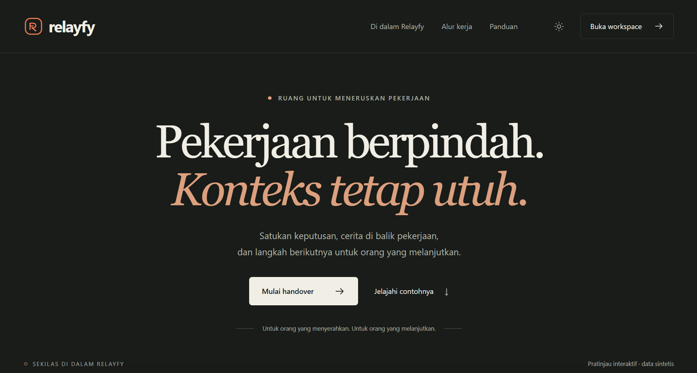
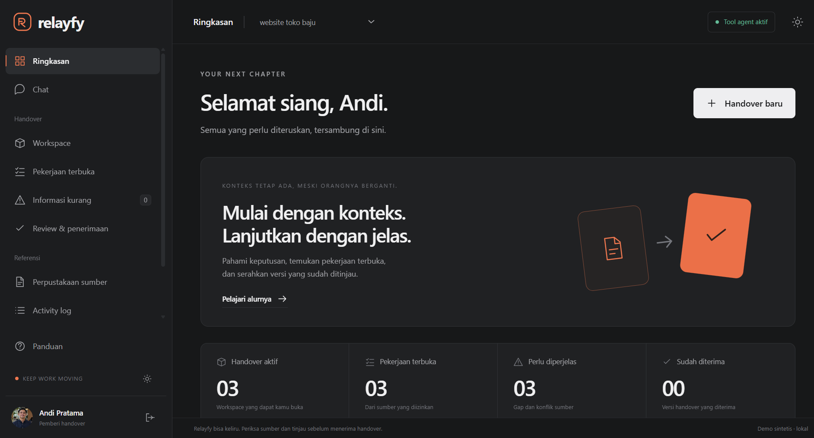

# Relayfy

**Pekerjaan berpindah. Konteks tetap utuh.**

Relayfy adalah asisten serah terima proyek. Saat penanggung jawab berganti, keputusan sering tercecer di dokumen, percakapan, dan daftar tugas. Relayfy menyatukannya dalam workspace agar penerima bisa memahami keputusan, membuka sumbernya, dan melihat pekerjaan yang masih perlu dilanjutkan.

**Tencent Cloud Hackathon Indonesia 2026 · Challenge A — The Workplace Brain · MVP 0.3**

[Mulai demo](#mulai-demo) · [Alur WorkBuddy](#alur-workbuddy) · [Bahan penilaian](#bahan-penilaian) · [Tencent](https://github.com/topics/tencent) · [AIClub](https://github.com/topics/aiclub)



## Yang bisa dicoba

| Kebutuhan | Yang dilakukan Relayfy |
| --- | --- |
| Memahami keputusan sebelumnya | Menampilkan kutipan yang bisa dibuka dari dokumen, ekspor chat, dan daftar tugas yang boleh dilihat pengguna. |
| Menentukan langkah berikutnya | Menampilkan tugas terbuka, PIC atau tenggat yang belum tercatat, serta konflik seperti dua tanggal peluncuran yang berbeda. |
| Menyerahkan versi yang sudah ditinjau | Pemberi meninjau draf privat dan membagikan satu versi. Penerima bisa meminta klarifikasi atau menerima versi tersebut. |
| Menjaga akses saat sumber berubah | Server memeriksa izin sebelum mengambil bukti. Perubahan sumber atau izin membuat brief, antrean, dan koneksi dari revisi sebelumnya tidak berlaku. |



## Mulai demo

Jalankan dengan **Python 3.10+**. Demo lokal menyiapkan data sintetis dan dapat dibuka tanpa instalasi paket tambahan atau API key.

```sh
git clone https://github.com/salmanfidinillah/relayfy.git
cd relayfy
python run_demo.py
```

Di Windows, kamu juga bisa membuka `START_RELAYFY.bat`. Di macOS atau Linux, gunakan `python3` bila perintah `python` tidak tersedia.

1. Buka [http://127.0.0.1:8765/](http://127.0.0.1:8765/), pilih **Buka workspace**, lalu masuk sebagai **Andi Pratama**.
2. Di **Workspace**, pilih **Lihat ringkasan bukti**. Buka satu kutipan dan periksa konflik tanggal peluncuran serta tugas pembayaran yang belum punya PIC atau tenggat.
3. Pilih **Tinjau & bagikan versi**, lalu konfirmasi. Ganti profil ke **Maya** dan buka **Review & penerimaan**. Periksa sumber, lalu minta klarifikasi atau terima versi itu.

Ringkasan bukti diambil langsung dari sumber. SQLite menyimpan progres antar-restart. Untuk mengulang dari data awal, gunakan `python run_demo.py --state ./demo-baru`. [Panduan demo lengkap](MULAI_DI_SINI.md)

## Alur WorkBuddy

**Web → pemeriksaan akses → antrean → WorkBuddy → validasi kutipan → review manusia**

Buat pertanyaan atau draf di web, lalu pilih **Hubungkan WorkBuddy**. Buka folder `relayfy-agent/` dalam task WorkBuddy dan jalankan prompt satu pekerjaan. Client CLI atau MCP mengambil bukti sesuai akun, workspace, revisi, dan tujuan. Setelah hasil dikirim kembali, server memeriksa kutipan dan izin terkini. Tindakan berbagi dan menerima versi tetap dikonfirmasi pengguna di web. [Panduan koneksi dan prompt](relayfy-agent/START_HERE.md)

Stack MVP memakai **Python/WSGI, SQLite, dan JavaScript/CSS**. Adapter API model tersedia sebagai opsi. [Arsitektur](submission/04_architecture.md) · [Panduan deployment](DEPLOY.md)

## Bahan penilaian

| Bahan | Isi |
| --- | --- |
| [Indeks paket penilaian](submission/00_index.md) | Deskripsi Challenge A, skenario, dan status bahan submission |
| [Accountability Sheet](submission/02_accountability_sheet.pdf) | Hak akses, batas tool, persetujuan manusia, dan audit |
| [Hasil tes](submission/03_test_results.md) | 84 pengujian otomatis mencakup core, web, dan runtime agent |
| [Catatan pengujian browser](evidence/browser-mvp.md) | Alur pemberi dan penerima pada data sintetis |
| [Naskah video demo](submission/05_demo_video_script.md) | Urutan demonstrasi fitur dan batas MVP |

Jalankan kembali pengujian dengan `python tests/run_tests.py`. CLI HTTP dan MCP stdio diuji dengan respons model simulasi. Pengujian di aplikasi WorkBuddy, inferensi model aktual, dataset resmi, dan deployment masih menunggu verifikasi. [Rincian hasil dan cakupan](submission/03_test_results.md)

---

**Pemilik proyek** Salman Fidinillah · [Prototipe CLI sebelumnya](README_LEGACY.md)
