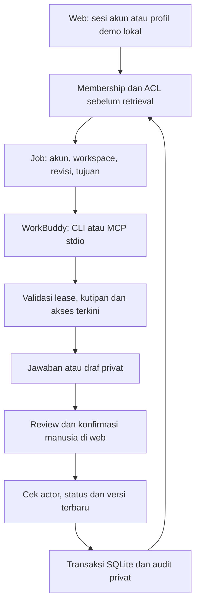

# Arsitektur dan batas kepercayaan

Diagram SVG: `04_architecture.svg`. Jalur utama memakai model WorkBuddy dalam aplikasi, melalui tools lokal. Backend tidak menganggap WorkBuddy mempunyai API model publik. Adapter provider Chat Completions tersedia opsional menggantikan tahap antrean/worker; kredensial hanya dibaca backend.

## Identitas dan sumber

Akun sungguhan: scrypt + cookie sesi acak yang hash-nya disimpan server, HttpOnly/SameSite, Secure untuk produksi. Mutasi UI memerlukan origin dan CSRF. Empat profil sintetis disediakan hanya oleh peluncur demo, dengan guard yang menolak demo di produksi. Klaim peran di chat tidak menjadi identitas.

Retrieval dilakukan setelah membership dan ACL. Browser hanya menerima sumber akun tersebut, worker hanya evidence job. Brief menggunakan korpus penerima yang juga dapat dibaca pemberi; task brief tidak membawa history pertanyaan privat pemberi. Kutipan diperiksa ulang saat dibuka. Riwayat hanya akun/workspace/revisi yang masih berizin.

## Batas worker

Key worker dihash, berlaku empat jam, satu akun/workspace/revisi/tujuan. HTTP worker hanya loopback tanpa browser Origin, membutuhkan bearer, lease dan job yang cocok. Pairing ulang membatalkan token serta lease lama. Worker tidak memiliki endpoint approve/import/ACL. Hasil baru masuk setelah validator JSON, ID kutipan, exact quote, status, revisi dan audiens lolos; transaksi hasil/job/audit dibatalkan bersama bila gagal.

Antrean Pending/Processing/Done/Failed/Cancelled tersimpan di database. Status Tool agent aktif hanya membuktikan pemanggilan client baru-baru ini, bukan identitas aplikasi WorkBuddy atau kualitas model. Bukti penggunaan WorkBuddy harus diambil dari percakapan dan tools aplikasi aktual.

Task WorkBuddy baru wajib setelah perubahan profil, tujuan atau revisi. Server dapat menolak hasil/akses lama, tetapi tidak dapat menghapus memori model. Shell pada OS yang sama bisa menjangkau file lain; folder terpisah bukan sandbox. Demo memakai data sintetis; penggunaan nyata memerlukan isolasi akun OS/container dan kebijakan filesystem.

## Persetujuan dan penyimpanan

Draf tidak otomatis dibagikan. Preview plan dan konfirmasi sesi manusia mendahului perubahan bisnis/berbagi. Actor, revisi, status dan versi brief terbaru diperiksa ulang saat transaksi. Klik approval pada uji otomatis hanya memverifikasi kode, bukan persetujuan manusia bisnis.

Data lokal: `~/.relayfy-mvp/relayfy.sqlite`, dipakai ulang setelah restart; tidak berada di ZIP. Produksi opsional: Gunicorn single instance dengan SQLite pada volume permanen di belakang HTTPS. Jalur WorkBuddy lokal tidak otomatis cocok untuk host publik; adapter API atau worker terisolasi perlu desain tambahan. Jangan membuka worker loopback ke internet tanpa perancangan ulang.

Perubahan sumber/ACL menaikkan revisi secara konservatif. Hasil, brief, history, cache/plan dan job lama tidak digunakan untuk request berikutnya. UI polling sekitar tiga detik; yang telah dilihat tetap tidak bisa ditarik kembali. Log UI hanya aktivitas sendiri pada revisi aktif. Audit historis tetap privat dan tidak tahan manipulasi administrator.

Trade-off MVP: retrieval kata/alias, task terstruktur, gap PIC/deadline dan konflik field; belum embeddings, OCR atau penentuan otoritas sumber otomatis. Kutipan persis tidak menjamin seluruh klaim benar secara semantik. Regex instruksi tersisip hanya filter terbatas.
